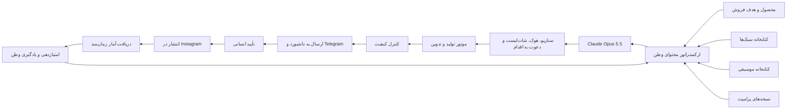

# پروپوزال اجرایی موتور هوشمند تولید و بهینه‌سازی ویدیوهای اینستاگرامی وطن

## وضعیت سند

- وضعیت: پیشنهاد اجرایی برای بررسی و تأیید
- دامنهٔ محصول: همهٔ محصولات فعال سایت؛ کیف و کفش فقط نمونهٔ اعتبارسنجی اولیه
- مالک تصمیم‌گیری: ادمین وطن
- استودیوی فعلی: حفظ کامل و بدون جایگزینی
- روش انتشار در فاز نخست: تأیید انسانی اجباری
- مدل اصلی تحلیل و تصمیم‌سازی: `Claude Opus 5.5 API`
- کانال همکاری و بازبینی: گروه موضوعی `Telegram`

---

## ۱. خلاصهٔ مدیریتی

وطن باید یک «موتور هوشمند تولید و یادگیری محتوای محصول» بسازد؛ نه فقط یک ابزار ساخت ویدیو.

این موتور باید بتواند:

1. محصول را دریافت کند.
2. هدف محتوا، صنف، مخاطب و پیشنهاد فروش را مشخص کند.
3. از بین کتابخانهٔ سبک‌ها، هوک‌ها، پرامپت‌ها و موسیقی‌ها پیشنهاد بدهد.
4. چند نسخهٔ کنترل‌شده از ویدیو تولید کند.
5. پیش‌نمایش را در داشبورد و `Telegram` برای تأیید ارسال کند.
6. فقط بخش اصلاحی ویدیو را دوباره تولید یا تدوین کند.
7. پس از تأیید انسانی منتشر کند.
8. آمار را از ده دقیقهٔ اول تا هفته‌ها بعد جمع‌آوری کند.
9. عملکرد را به سبک، پرامپت، هوک، موسیقی، زمان انتشار و محصول متصل کند.
10. پیشنهاد بعدی را با دلیل، نمونهٔ آماری و میزان اطمینان ارائه دهد.

مزیت اصلی وطن در این سیستم، خودِ تولید ویدیو نیست؛ بلکه ایجاد یک حافظهٔ قابل‌اندازه‌گیری از این است که کدام ترکیب خلاقه برای کدام محصول و صنف بهتر جواب می‌دهد.

تقویم محتوایی یک مرحلهٔ مستقل و اجباری پیش از سناریونویسی و تولید است. هیچ ویدیویی نباید پیش از تأیید تقویم ماهانه وارد صف تولید شود.

---

## ۲. تصمیم‌های قطعی این پروپوزال

### ۲.۱ مدل‌ها

- `Claude Opus 5.5`: طراحی استراتژی، سناریو، تحلیل عمیق، ساخت پرامپت، داوری نسخه‌ها و تحلیل هفتگی.
- `Claude Sonnet 5.5`: ساخت نسخه‌های متعدد هوک، کپشن، دعوت به اقدام و سناریوهای روزمره.
- `Claude Haiku 5.5`: برچسب‌گذاری، طبقه‌بندی، پاک‌سازی داده و وظایف پرتعداد کم‌هزینه.
- موتور ویدیو و رندر جداگانه: ساخت کلیپ، ترکیب قطعه‌ها، متن، افکت، صدا و خروجی نهایی.

`Claude Opus 5.5 API` مغز محتوایی سیستم است، نه موتور بومی رندر فایل ویدیو. در اپلیکیشن دسکتاپ ممکن است `Claude` با ابزارهای متصل یا محیط‌های تعاملی، فرآیند تولید ویدیو را هدایت کند؛ اما در داشبورد وطن، خروجی `Opus` باید به‌صورت ساختاریافته به موتور تولید و تدوین ارسال شود.

مستندات رسمی `Anthropic` قابلیت‌های اصلی `Claude API` را تولید متن و کد و تحلیل ورودی‌های تصویری معرفی می‌کنند، نه رندر بومی ویدیو: [مستندات قابلیت بینایی Claude](https://docs.anthropic.com/en/docs/build-with-claude/vision)

### ۲.۲ اتصال‌ها

اتصال فعلی `Instagram` حفظ می‌شود و جایگزین نمی‌شود. این اتصال وظیفهٔ دریافت پست، آمار، کامنت، دایرکت و در صورت تأیید دسترسی‌ها، انتشار را دارد.

`Claude API` وظیفهٔ تحلیل و تصمیم‌سازی دارد. داشبورد وطن این دو را به‌وسیلهٔ یک ارکستراتور مشترک به هم متصل می‌کند.

اتصال اینستاگرام به‌تنهایی تمام قدرت کلاد را فراهم نمی‌کند؛ همان‌طور که `Claude API` نیز به‌تنهایی دسترسی اینستاگرام ندارد.

### ۲.۳ استودیوی فعلی

استودیوی فعلی ویدیو باید حفظ شود. موتور جدید با عنوان و مسیر مستقل ساخته می‌شود و در صورت نیاز از سرویس‌ها، صف‌ها و مدل‌های موجود استفاده می‌کند؛ اما رفتار، رابط و مسیر قبلی نباید حذف یا خراب شود.

عنوان پیشنهادی ماژول جدید:

## کارخانهٔ هوشمند محتوای وطن

### ۲.۴ کنترل انسانی

در فاز نخست هیچ انتشار یا تغییر پرامپت مهمی بدون تأیید انسانی انجام نمی‌شود. سیستم می‌تواند پیشنهاد بدهد، نسخه بسازد و هشدار دهد؛ اما انتشار نهایی و فعال‌سازی قواعد یادگیری با ادمین است.

---

## تقویم محتوایی پیش‌تولید؛ مرحلهٔ صفر اجباری

هدف این بخش این است که وطن پیش از تولید هر سناریو، ابتدا بداند در ماه آینده چه چیزی، برای چه محصولی، با چه هدفی و در چه قالبی باید منتشر شود.

### اصل اجرایی

فرایند باید چنین باشد:

`پرسش‌نامهٔ تخصصی ← تحلیل کسب‌وکار ← پیشنهاد ستون‌های محتوا ← طراحی سناریوها ← ساخت تقویم ماهانه ← تأیید ادمین ← صف تولید`

### گفت‌وگوی تخصصی با ادمین

`Claude Opus 5.5` نباید صد سؤال ثابت و خسته‌کننده را یک‌جا بپرسد. باید پرسش‌نامه را تطبیقی و چندمرحله‌ای اجرا کند:

#### دور اول: هدف و وضعیت کسب‌وکار

- هدف اصلی ماه آینده چیست؟
- تمرکز روی فروش، آگاهی، دایرکت، ثبت‌نام یا معرفی محصول است؟
- مهم‌ترین محصولات و پیشنهادهای فروش کدام‌اند؟
- ظرفیت تولید ماهانه چقدر است؟
- چه مناسبت‌ها یا کمپین‌هایی در پیش است؟

#### دور دوم: محصول و مخاطب

- هر محصول برای چه مخاطبی است؟
- محصول چه مزیت متمایزی دارد؟
- کدام محصول تازه، کم‌فروش یا استراتژیک است؟
- چه ادعاهایی ممنوع یا حساس هستند؟
- برای کدام صنف دادهٔ کافی نداریم؟

#### دور سوم: برند و محتوا

- لحن برند رسمی، صمیمی، لوکس، آموزشی یا هیجانی است؟
- چه نوع هوک‌هایی تأیید یا رد می‌شوند؟
- چه سبک‌های بصری باید بیشتر دیده شوند؟
- چه موسیقی‌هایی مجاز و مطلوب‌اند؟
- نسبت موردنظر ویدیو، پست، پست اسلایدی و استوری چیست؟

#### دور چهارم: یادگیری و اصلاح

- عملکرد ماه قبل چه نکته‌ای دارد؟
- چه سبک‌ها یا موسیقی‌هایی نباید تکرار شوند؟
- کدام محصول‌ها هنوز محتوای کافی ندارند؟
- چه آزمایش‌هایی باید در ماه بعد انجام شود؟

سیستم بر اساس پاسخ‌های قبلی سؤال‌های بعدی را تغییر می‌دهد و فقط سؤال‌های لازم را می‌پرسد. ادمین می‌تواند هر بخش را ویرایش، رد یا دوباره اجرا کند.

### ستون‌های محتوا

پیش از ساخت تقویم، سیستم چند ستون محتوایی برای ماه پیشنهاد می‌دهد؛ برای نمونه:

- معرفی محصول
- نمایش جزئیات و کیفیت
- حل مسئلهٔ مشتری
- مقایسه و انتخاب
- آموزش و راهنمای خرید
- اعتمادسازی و پشت‌صحنه
- مناسبت و کمپین فروش
- محتوای تعاملی و سؤال‌محور

ادمین ستون‌ها را تأیید، حذف یا اصلاح می‌کند.

### خروجی تقویم ماهانه

تقویم باید هم در نمای تقویمی و هم در نمای جدول ارائه شود. هر ردیف حداقل این ستون‌ها را دارد:

- تاریخ و ساعت پیشنهادی
- پلتفرم
- نوع محتوا: ویدیو، پست، پست اسلایدی یا استوری
- محصول
- صنف
- مخاطب
- هدف
- ستون محتوایی
- ایده و سناریوی خلاصه
- هوک پیشنهادی
- دعوت به اقدام
- سبک پیشنهادی
- موسیقی پیشنهادی
- نسخهٔ پرامپت
- وضعیت تولید
- وضعیت تأیید
- لینک رهگیری
- نتیجهٔ پس از انتشار

### کنترل ظرفیت و توازن

سیستم باید پیش از تأیید تقویم بررسی کند:

- تعداد کل ویدیوها
- تعداد کل پست‌ها
- تعداد پست‌های اسلایدی
- تعداد استوری‌ها
- تعداد محتوا برای هر محصول
- تعداد محتوا برای هر صنف
- تکرار سبک‌ها
- تکرار موسیقی‌ها
- فاصلهٔ انتشار محتواهای مشابه
- ظرفیت واقعی تولید و رندر
- وجود یا نبود دارایی و عکس محصول

نسبت‌ها باید قابل‌تنظیم باشند؛ مثلاً ادمین می‌تواند تعیین کند در یک ماه مشخص، چند درصد محتوا ویدیویی، چند درصد پست و چند درصد اسلایدی باشد.

### پیشنهاد فرصت‌ها

پیش از تأیید تقویم، سیستم باید کمبودها را اعلام کند:

- محصولی که هیچ محتوایی ندارد.
- صنفی که کمتر از حد تعیین‌شده محتوا گرفته است.
- سبک آزمایش‌نشده.
- موسیقی بیش‌ازحد تکرارشده.
- روز یا هفتهٔ بدون محتوای مهم.
- محصولی که دادهٔ عملکرد کافی ندارد.

### قفل تأیید

با تأیید ادمین، نسخهٔ تقویم قفل می‌شود و برای هر ردیف یک آیتم تولید مستقل ساخته می‌شود. تغییر بعدی باید نسخهٔ جدید تقویم ایجاد کند و اثر آن روی صف تولید، زمان‌بندی و بودجه مشخص باشد.

### چرخهٔ ماهانه

1. اجرای پرسش‌نامهٔ تطبیقی.
2. جمع‌آوری وضعیت محصولات و کمپین‌ها.
3. تحلیل عملکرد ماه قبل.
4. پیشنهاد ستون‌ها و نسبت محتوا.
5. پیشنهاد سناریوها برای همهٔ محصولات فعال.
6. ساخت جدول تقویم.
7. بررسی ظرفیت، تکرار، مجوز و تعادل.
8. تأیید یا اصلاح توسط ادمین.
9. تبدیل ردیف‌های تأییدشده به صف تولید.
10. تولید و تأیید هر محتوا.
11. انتشار و جمع‌آوری آمار.
12. ورود یادگیری‌ها به تقویم ماه بعد.

این بخش باید در ماژول جدید با عنوان «تقویم محتوایی هوشمند» دیده شود و قبل از «کارخانهٔ تولید» قرار بگیرد.

---

## ۳. معماری کلان

سه لایه باید از هم جدا باشند:

### لایهٔ دسترسی

اتصال‌های `Meta`، `Composio` یا اتصال رسمی آینده، همراه با مدیریت توکن، مجوز، وب‌هوک و محدودیت نرخ.

### لایهٔ هوش

`Claude API`، قواعد ثابت، موتور امتیازدهی و تحلیل آماری.

### لایهٔ محصول

داشبورد وطن، صف‌ها، تأیید، تاریخچه، کتابخانه، `Telegram` و گزارش‌ها.

---

## ۴. بانک سبک‌های ویدیویی

برای شروع بین سی تا پنجاه سبک یا الگوی ویدیویی وارد می‌شود. هر سبک باید یک شناسنامهٔ مستقل داشته باشد.

### اطلاعات هر سبک

- نام فارسی
- نام انگلیسی
- توضیح قابل‌فهم برای ادمین
- هدف مناسب: معرفی، فروش، آگاهی، کامنت، دایرکت یا کلیک
- صنف‌های مناسب
- محصول‌های مناسب
- مدت پیشنهادی
- نسبت تصویر
- تعداد شات
- حرکت دوربین
- نوع متن روی تصویر
- خانوادهٔ هوک
- خانوادهٔ دعوت به اقدام
- موسیقی‌های مناسب
- نمونه‌های مرجع
- نسخهٔ پرامپت اصلی
- تعداد استفاده
- امتیاز فعلی
- میزان اطمینان
- آخرین زمان استفاده
- وضعیت فعال، آزمایشی، بایگانی یا قفل‌شده

### ورود چهل تا پنجاه ویدیوی مرجع

فرایند ورود ویدیوهای مرجع:

1. بارگذاری فایل‌ها در مخزن امن وطن.
2. استخراج فریم‌های منتخب، صدا، مدت، نسبت و نقاط برش.
3. تحلیل بصری، ریتم، شات، متن، رنگ، حرکت و ساختار.
4. تولید توضیح سبک توسط `Claude Opus 5.5`.
5. پیشنهاد دسته‌بندی و نام سبک.
6. تأیید یا ویرایش توسط ادمین.
7. ساخت پوشهٔ منطقی و رکورد رسمی سبک.

`Claude API` به‌صورت خودکار یک پوشهٔ مک را برای همیشه رصد نمی‌کند. برای داشبورد، فایل‌ها باید از طریق بارگذاری امن یا فضای ذخیره‌سازی کنترل‌شده وارد صف تحلیل شوند.

بعد از ورود نمونه‌های جدید، سیستم باید تشخیص دهد که نمونه:

- متعلق به یک سبک موجود است.
- ترکیبی از چند سبک موجود است.
- احتمالاً سبک تازه‌ای است.
- برای تصمیم قطعی دادهٔ کافی ندارد.

---

## ۵. سیستم پرامپت و ژن محتوایی

هر ویدیو باید علاوه بر فایل نهایی، شناسنامهٔ کامل تولید داشته باشد.

### اجزای ژن محتوایی

- سبک بصری
- خانوادهٔ هوک
- متن هوک
- ساختار روایت
- حرکت و افکت
- نوع محصول
- صنف
- مخاطب
- هدف
- موسیقی
- زمان انتشار
- دعوت به اقدام
- متن روی تصویر
- کپشن
- هشتگ یا کلیدواژه
- مدل استفاده‌شده
- نسخهٔ پرامپت
- ورودی‌های پرامپت
- هزینهٔ تولید
- زمان ساخت
- نتیجهٔ انتشار

### لایه‌های پرامپت

پرامپت واحد و غیرقابل‌ردیابی ساخته نشود. پرامپت‌ها به اجزای قابل‌مدیریت تقسیم شوند:

1. شناخت محصول
2. وفاداری محصول و لوگو
3. انتخاب سبک
4. ساخت هوک
5. ساخت سناریو
6. انتخاب حرکت
7. پیشنهاد موسیقی
8. ساخت کپشن
9. دعوت به اقدام
10. کنترل کیفیت
11. تحلیل عملکرد
12. پیشنهاد آزمایش بعدی

در داشبورد باید مشخص باشد هر پرامپت:

- در کدام بخش استفاده می‌شود.
- به کدام سبک‌ها وابسته است.
- چه نسخه‌هایی دارد.
- با چه ویدیوهایی اجرا شده است.
- چه امتیازی گرفته است.
- چه کسی آن را ویرایش کرده است.
- امکان بازگردانی به نسخهٔ قبلی دارد یا نه.

کلاد نباید مستقیماً پرامپت فعال تولید را تغییر دهد. ابتدا پیشنهاد در وضعیت پیش‌نویس ذخیره می‌شود، سپس ادمین آن را تأیید یا رد می‌کند.

---

## ۶. مرکز همکاری در `Telegram`

یک گروه خصوصی با حالت موضوعی ساخته می‌شود. `Telegram` مرکز تعامل، بازبینی و ارسال نظر است؛ اما منبع اصلی نسخه‌ها و داده‌ها، پایگاه داده و ذخیره‌سازی وطن باقی می‌ماند.

### موضوع‌های پیشنهادی گروه

- سبک‌ها و نمونه‌ها
- موسیقی
- هوک‌ها
- پرامپت‌ها
- ویدیوهای در انتظار تأیید
- اصلاحیه‌ها
- نسخه‌های نهایی
- گزارش یادگیری

هر پیام باید به یک رکورد وطن متصل شود:

- شناسهٔ پیام
- شناسهٔ فایل
- فرستنده
- موضوع
- زمان
- نسخه
- سبک
- محصول
- کمپین
- وضعیت تأیید

اگر فایل در `Telegram` حذف یا ویرایش شد، نسخهٔ اصلی وطن نباید از بین برود.

---

## ۷. کتابخانهٔ موسیقی

کلاد از خودش موسیقی تولید نمی‌کند. موسیقی فقط از کتابخانهٔ تأییدشده انتخاب می‌شود.

### اطلاعات هر موسیقی

- نام فایل
- نام نمایشی
- منبع
- حال‌وهوا
- سرعت تقریبی
- مدت
- سبک موسیقی
- صنف مناسب
- نوع ویدیو مناسب
- وضعیت مجوز
- امکان استفادهٔ تجاری
- تاریخ اضافه‌شدن
- تعداد استفاده
- آخرین استفاده
- امتیاز عملکرد
- وضعیت فعال یا ممنوع

استفادهٔ دوباره از موسیقی موفق مجاز است؛ اما باید آگاهانه و با ثبت دلیل باشد.

موسیقی‌های ترند کتابخانهٔ عادی `Instagram` الزاماً برای استفادهٔ تجاری مجاز نیستند. برای تبلیغات، موسیقی اختصاصی، موسیقی دارای مجوز تجاری یا `Meta Sound Collection` انتخاب شود. [راهنمای رسمی مجوز موسیقی Instagram](https://www.facebook.com/help/instagram/402084904469945)

---

## ۸. اصلاحیهٔ بخشی و نسخه‌بندی ویدیو

هر ویدیو باید به قطعه‌ها و نقاط زمانی قابل‌ارجاع تقسیم شود.

مثال: اگر ویدیوی پانزده‌ثانیه‌ای در ثانیهٔ هشت تا ده نیاز به اصلاح داشت:

1. بازهٔ `00:08` تا `00:10` در داشبورد ثبت می‌شود.
2. ادمین توضیح اصلاحیه را می‌نویسد.
3. فقط همان قطعه دوباره تولید یا تدوین می‌شود.
4. قطعهٔ جدید با بقیهٔ قطعه‌های تأییدشده ترکیب می‌شود.
5. صدا، زیرنویس و افکت‌ها بررسی می‌شوند.
6. نسخهٔ جدید برای تأیید ارسال می‌شود.

دو نوع اصلاحیه پشتیبانی شود:

- اصلاح تدوینی: متن، برش، رنگ، موسیقی، افکت و زمان‌بندی
- اصلاح مولد: بازتولید همان بخش تصویری با حفظ محصول، سبک و مرجع قبلی

نسخه‌ها حذف نشوند:

`نسخهٔ ۱ ← نسخهٔ ۲ ← نسخهٔ ۳`

---

## ۹. کنترل کیفیت

کنترل کیفیت دو مرحله دارد.

### کنترل خودکار

- نسبت `9:16`
- حجم و فرمت
- نبود فریم سیاه
- خوانایی متن فارسی
- ناحیهٔ امن متن
- حفظ رنگ و شکل محصول
- حفظ لوگو و نوشتهٔ بسته‌بندی
- نبود ادعاهای درمانی یا گمراه‌کننده
- وجود موسیقی مجاز
- صحت لینک و دعوت به اقدام
- هماهنگی صدای گوینده و زیرنویس

### کنترل انسانی

ادمین در داشبورد یا تلگرام باید بتواند:

- تأیید کند.
- رد کند.
- اصلاحیهٔ زمانی بدهد.
- سبک را عوض کند.
- موسیقی را عوض کند.
- هوک را عوض کند.
- کپشن را ویرایش کند.
- نسخهٔ قبلی را بازگرداند.

---

## ۱۰. انتشار و جمع‌آوری آمار

پس از تأیید انسانی، ویدیو برای انتشار ارسال می‌شود. در فاز نخست، انتشار خودکار باید محدود و قابل‌توقف باشد.

### بازه‌های جمع‌آوری

- ده دقیقه
- سی دقیقه
- یک ساعت
- سه ساعت
- شش ساعت
- دوازده ساعت
- بیست‌وچهار ساعت
- هفتادودو ساعت
- هفت روز
- بیست‌وهشت روز

### داده‌های پیشنهادی

- نمایش
- دسترسی
- لایک
- کامنت
- ذخیره
- اشتراک‌گذاری
- بازدید پروفایل
- دنبال‌کردن
- کلیک
- دایرکت
- کامنت کلیدی
- زمان تماشا
- میانگین زمان تماشا
- نرخ تکمیل
- تماشای مجدد
- ثبت‌نام
- ساخت محصول
- خرید
- درآمد
- هزینهٔ ساخت

هر دادهٔ خام `API` نیز ذخیره شود تا در آینده امکان بازتحلیل وجود داشته باشد. اگر شاخصی از `Meta` قابل دریافت نباشد، مقدار آن `null` یا «دریافت‌نشده» باشد، نه صفر جعلی.

در کد فعلی وطن، همگام‌سازی پست و بخشی از آمار مانند `saved`، `shares` و `reach` وجود دارد؛ اما برداشت‌های زمان‌مند، پاسخ خام و تحلیل کامل نگهداشت باید به آن اضافه شود.

---

## ۱۱. امتیازدهی داخلی وطن

امتیاز هر ویدیو به اجزای آن متصل می‌شود:

`سبک + پرامپت + هوک + موسیقی + حرکت + دعوت به اقدام + زمان انتشار + نتیجهٔ کسب‌وکاری`

امتیاز باید چند لایه داشته باشد:

### امتیاز توجه

بر پایهٔ نمایش، زمان تماشا، تکمیل و تماشای مجدد.

### امتیاز تعامل

بر پایهٔ ذخیره، اشتراک‌گذاری، کامنت و بازدید پروفایل.

### امتیاز کسب‌وکار

بر پایهٔ کلیک، دایرکت، ثبت‌نام، ساخت محصول و خرید.

### امتیاز اقتصادی

بر پایهٔ هزینهٔ تولید نسبت به نتیجه.

سیستم باید تعداد نمونه و میزان اطمینان را همراه امتیاز نشان دهد. اگر داده کم باشد، نتیجه «نامشخص» اعلام شود.

---

## ۱۲. یادگیری و پیشنهاد خودکار

در فاز ابتدایی، تمرکز روی تحلیل آماری قابل‌توضیح است؛ نه ادعای یک سیستم پیچیدهٔ خودکار.

هر گزارش یادگیری باید نشان دهد:

- چه چیزی کشف شده است.
- بر اساس چند نمونه است.
- مربوط به چه بازه‌ای است.
- کدام صنف‌ها را پوشش می‌دهد.
- میزان اطمینان چقدر است.
- از کدام ویدیوها استفاده شده است.
- چه پیشنهادی برای تولید بعدی دارد.
- چه کسی آن را تأیید یا رد کرده است.

نمونهٔ پیشنهاد:

> در یک صنف یا گروه محصول، سبک «زوم لوکس» با هوک نتیجه‌محور در هفت نمونه، ذخیره و اشتراک‌گذاری بیشتری از میانگین داشته است؛ اما داده برای نتیجهٔ قطعی هنوز کافی نیست. پیشنهاد: سه آزمایش دیگر با همان سبک و محصولات متفاوت.

### پیشنهاد فرصت‌های کم‌کارشده

سیستم باید فرصت‌ها را شناسایی کند:

- صنف‌هایی که هنوز داده ندارند.
- محصول‌هایی که ویدیو ندارند.
- سبک‌هایی که آزمایش نشده‌اند.
- موسیقی‌هایی که بیش‌ازحد تکرار شده‌اند.
- سبک‌هایی که بیش‌ازحد استفاده شده‌اند.
- صنف‌هایی با ظرفیت بازار و محتوای کم.

کلاد پیشنهاد می‌دهد؛ ادمین تصمیم نهایی را می‌گیرد.

---

## ۱۳. صفحات ماژول جدید داشبورد

### داشبورد فرماندهی

- محتواهای در صف
- ویدیوهای در انتظار تأیید
- خطاهای تولید و اتصال
- هزینهٔ روزانه
- نتیجهٔ هفتگی
- پیشنهادهای جدید سیستم

### کارخانهٔ تولید

- انتخاب محصول
- انتخاب هدف
- انتخاب صنف
- پیشنهاد سبک
- پیشنهاد هوک
- پیشنهاد موسیقی
- ساخت چند نسخه
- ارسال به تأیید

### کتابخانهٔ سبک‌ها

- فهرست سبک‌ها
- نمونه‌ها
- پوشه‌های منطقی
- امتیاز سبک
- تاریخچهٔ استفاده
- افزودن سبک جدید
- ادغام یا بایگانی سبک‌ها

### کتابخانهٔ موسیقی

- فایل‌ها
- وضعیت مجوز
- حال‌وهوا
- تعداد استفاده
- نتیجهٔ عملکرد
- جلوگیری از تکرار ناخواسته

### آزمایشگاه پرامپت

- مشاهدهٔ کامل پرامپت
- نسخه‌بندی
- وابستگی‌ها
- ویدیوهای ساخته‌شده
- ویرایش و پیش‌نویس
- تأیید و انتشار نسخه
- بازگردانی

### صف تأیید و اصلاحیه

- پیش‌نمایش
- تأیید
- رد
- اصلاحیهٔ زمانی
- نظر ادمین
- مقایسهٔ نسخه‌ها

### تحلیل و یادگیری

- آمار زمان‌مند
- امتیاز سبک
- امتیاز پرامپت
- امتیاز موسیقی
- برنده‌ها و بازنده‌ها
- فرصت‌های کم‌کارشده
- گزارش‌های قابل‌ویرایش

---

## ۱۴. مدل دادهٔ پیشنهادی

به‌جای ساخت سامانهٔ موازی، از مدل‌های موجود وطن استفاده و فقط لایه‌های لازم اضافه شود.

موجودیت‌های پیشنهادی:

- `creative_styles`
- `style_reference_assets`
- `prompt_versions`
- `music_assets`
- `content_experiments`
- `content_variants`
- `content_segment_edits`
- `publication_metric_snapshots`
- `learning_insights`
- `telegram_asset_links`

رکورد مرکزی باید این زنجیره را نگه دارد:

`محصول ← کمپین ← سبک ← پرامپت ← نسخهٔ ویدیو ← اصلاحیه ← انتشار ← آمار ← یادگیری`

برای جلوگیری از پراکندگی، یک محتوای منتشرشده نباید هم‌زمان چند `ID` مستقل و بی‌ارتباط در `Marketing Technology`، `Growth` و `Smart Instagram` داشته باشد.

---

## ۱۵. اتصال به وضعیت فعلی پروژه

این طرح باید روی قطعات فعلی سوار شود:

- استودیوی ویدیو: `app/Http/Controllers/Admin/VideoStudioController.php`
- همگام‌سازی پست: `app/Services/SmartInstagram/Posts/PostSyncService.php`
- اتصال `Meta`: `app/Services/SmartInstagram/Gateways/MetaInstagramGateway.php`
- اتصال `Composio`: `app/Services/SmartInstagram/Gateways/ComposioInstagramGateway.php`
- ساختار کمپین و محتوا: `database/migrations/2026_09_02_090000_create_marketing_technology_tables.php`
- مسیرهای پنل اینستاگرام هوشمند: `routes/smart-instagram.php`

دو سیستم موازی اینستاگرام نباید برای همیشه مرجع داده باشند. پیش از توسعهٔ امتیازدهی، مرجع نهایی رویدادها، پست‌ها و آمار باید مشخص شود.

---

## ۱۶. برنامهٔ اجرایی مرحله‌به‌مرحله

### فاز صفر: پایه و یکپارچه‌سازی

1. تعیین شناسهٔ مرجع محتوا.
2. بررسی اتصال فعلی `Instagram`.
3. بررسی مجوزهای واقعی دریافت آمار و انتشار.
4. مشخص‌کردن ظرفیت سرور و صف رندر.
5. تعریف واژگان سبک، هوک، موسیقی و پرامپت.
6. ثبت سه ساخت واقعی برای سنجش هزینه، زمان و کیفیت.

### فاز یک: کتابخانهٔ سبک و موسیقی

1. ایجاد گروه موضوعی خصوصی `Telegram`.
2. بارگذاری چهل تا پنجاه ویدیوی مرجع.
3. تحلیل و دسته‌بندی اولیه.
4. تأیید انسانی سبک‌ها.
5. ورود موسیقی‌ها و ثبت مجوز.
6. ایجاد جست‌وجو و فیلتر در داشبورد.

### فاز دو: تولید کنترل‌شده

1. انتخاب مجموعه‌ای از محصولات فعال از چند صنف برای اعتبارسنجی بین‌صنفی.
2. انتخاب پنج تا ده محصول واقعی.
3. ساخت سه نسخه برای هر محصول.
4. تأیید انسانی.
5. ثبت کامل سبک، پرامپت، هوک و موسیقی.
6. انتشار محدود.

### فاز سه: اصلاحیه و انتشار

1. ارسال پیش‌نمایش به داشبورد و `Telegram`.
2. ثبت اصلاحیهٔ زمانی.
3. بازتولید یا تدوین قطعهٔ اصلاحی.
4. ساخت نسخهٔ جدید.
5. تأیید انسانی.
6. انتشار با شناسهٔ رهگیری.

### فاز چهار: آمار و تحلیل

1. برداشت ده‌دقیقه‌ای.
2. برداشت ساعتی.
3. برداشت روزانه.
4. ذخیرهٔ پاسخ خام.
5. نرمال‌سازی شاخص‌ها.
6. اتصال آمار به ژن محتوا.

### فاز پنج: یادگیری و پیشنهاد

1. رتبه‌بندی سبک‌ها.
2. رتبه‌بندی پرامپت‌ها.
3. رتبه‌بندی موسیقی‌ها.
4. تشخیص کمبود داده.
5. پیشنهاد آزمایش بعدی.
6. تأیید یا رد پیشنهاد توسط ادمین.

### فاز شش: خودکارسازی تدریجی

1. زمان‌بندی انتشار.
2. سقف هزینه.
3. سقف انتشار.
4. توقف اضطراری.
5. انتشار خودکار محدود.
6. توسعه به صنف‌های دیگر.

---

## ۱۷. معیار پذیرش نسخهٔ اولیه

نسخهٔ اولیه زمانی پذیرفته است که:

- حداقل ده محصول فعال از چند صنف وارد چرخه شده باشد و مدل داده برای گسترش به همهٔ محصولات آماده باشد.
- برای هر محصول چند نسخهٔ سبک و پرامپت ثبت شده باشد.
- هر ویدیو شناسنامهٔ کامل داشته باشد.
- اصلاحیهٔ زمانی حداقل در یک سناریوی واقعی کار کند.
- تأیید انسانی از داشبورد یا `Telegram` انجام شود.
- آمار زمان‌مند برای انتشار ذخیره شود.
- نتیجه به سبک، پرامپت و موسیقی متصل باشد.
- گزارش برنده و بازنده قابل مشاهده باشد.
- هزینهٔ واقعی هر ساخت مشخص باشد.
- سیستم در نبود داده، نتیجهٔ قطعی جعلی تولید نکند.
- استودیوی فعلی همچنان بدون تغییر کار کند.

---

## ۱۸. ریسک‌ها و کنترل آن‌ها

### ریسک دسترسی اینستاگرام

ممکن است بعضی شاخص‌ها یا قابلیت انتشار برای حساب، کشور یا نوع اتصال در دسترس نباشد. باید قبل از وعدهٔ محصول، دسترسی واقعی در یک حساب تست بررسی شود.

### ریسک موسیقی

هر فایل موسیقی باید وضعیت مجوز داشته باشد. موسیقی بدون مجوز تجاری وارد مسیر انتشار خودکار نشود.

### ریسک کیفیت محصول

مدل ممکن است لوگو، متن، رنگ یا شکل محصول را تغییر دهد. کنترل تصویری و تأیید انسانی برای محصولات حساس الزامی است.

### ریسک دادهٔ کم

در شروع، سیستم باید آزمایش طراحی کند و داده جمع کند؛ نه اینکه با چند پست نتیجهٔ قطعی صادر کند.

### ریسک هزینه

`Opus` برای همهٔ کارها استفاده نشود. برای کارهای پرتعداد، `Sonnet` و `Haiku` مناسب‌ترند. هزینهٔ مدل، رندر، ذخیره‌سازی و انتشار به تفکیک ثبت شود.

### ریسک زیرساخت

رندر و تحلیل نباید داخل درخواست وب انجام شود. صف، تلاش مجدد، قفل، زمان‌انقضا و توقف اضطراری لازم است.

### ریسک تغییر ناخواسته

تمام پرامپت‌ها، سبک‌ها، موسیقی‌ها، گزارش‌های یادگیری و خروجی‌ها نسخه‌بندی و قابل بازگشت باشند.

---

## ۱۹. چیزهایی که در نسخهٔ اول ساخته نمی‌شوند

- انتشار نامحدود و کاملاً خودکار
- تغییر خودکار پرامپت فعال بدون تأیید
- کپی خودکار ترندهای دیگران
- انتخاب موسیقی صرفاً بر اساس محبوبیت
- حذف استودیوی ویدیوی فعلی
- ساخت یک پایگاه دادهٔ موازی و جدا از مدل‌های فعلی
- اعلام برنده بر اساس فقط لایک
- تعمیم نتیجهٔ یک صنف به همهٔ صنف‌ها

---

## ۲۰. نتیجهٔ نهایی

محصول پیشنهادی وطن یک «ماشین هوشمند تولید ریلز» نیست؛ یک «سیستم یادگیرندهٔ رشد محتوای محصول» است.

این سیستم باید بتواند از هر ویدیو یاد بگیرد:

- چه سبکی استفاده شد.
- چه پرامپتی فعال بود.
- چه هوکی نوشته شد.
- چه موسیقی‌ای پخش شد.
- چه زمانی منتشر شد.
- چه آماری گرفت.
- چه نتیجهٔ کسب‌وکاری ایجاد کرد.
- آیا ارزش تکرار یا تغییر دارد.

قاعدهٔ نهایی:

> هیچ پیشنهاد خودکاری بدون ثبت دادهٔ مبنا، نسخه، دلیل، میزان اطمینان و امکان بازگشت وارد سیستم تولید نشود.

منابع رسمی مرتبط:

- [صفحهٔ رسمی Claude Opus](https://www.anthropic.com/claude/opus)
- [مستندات بینایی Claude](https://docs.anthropic.com/en/docs/build-with-claude/vision)
- [راهنمای رسمی موسیقی Instagram](https://www.facebook.com/help/instagram/402084904469945)
- [راهنمای رسمی ساخت محتوای Reels برای کسب‌وکار](https://www.facebook.com/business/ads/facebook-instagram-reels-ads)
- [راهنمای رسمی حقوق مؤلف در Instagram](https://www.facebook.com/help/354736791367645/)

